<h1 align="center">Maksim Sitnikov</h1>

  

  <b>Fullstack .NET developer</b> 
  C# | ASP.NET Core | React | Kubernetes | AI-assisted development 
  Moscow. Open to work: remote or hybrid. 
  Fullstack .NET разработчик, Москва. Ищу работу, удалённо или гибрид.

    

I build web products end to end: backends in C# and ASP.NET Core, frontends in React and TypeScript, PostgreSQL underneath, and I ship them to Docker and Kubernetes through CI/CD. More than 8 years in commercial development, mostly in payments, anti-fraud, LegalTech and government API integrations.

I work with AI coding agents (Claude Code, Codex) every day. The agents write and check code on my tasks. I own the architecture, the review and the result.

## Contribution graph

<!-- pacman -->
<picture>
    <source media="(prefers-color-scheme: dark)" srcset="https://raw.githubusercontent.com/yellow444/yellow444/output/pacman-contribution-graph-dark.svg">
    <source media="(prefers-color-scheme: light)" srcset="https://raw.githubusercontent.com/yellow444/yellow444/output/pacman-contribution-graph.svg">
    
</picture>

## What I work on

- **Payments.** Backend of the XPay cloud payment system (Xpress Super App): wallets, merchants, external payment gateways, event sourcing, .NET 10.
- **Anti-fraud.** Event-driven fraud detection services for a telecom operator (SberMobile): .NET 8, Kafka, Redis, up to 2 million requests a day, test coverage up to 85%, Prometheus and Grafana monitoring.
- **LegalTech.** More than 10 microservices on ASP.NET Core, RabbitMQ and React for a legal services platform. I set up Docker, Kubernetes, Helm and GitLab CI for it myself.
- **Government integrations.** Gosuslugi (the Russian public services portal) and EFRSB APIs with qualified electronic signatures. I connected the Gosuslugi API for four companies and wrote about it on Habr.
- **AI-assisted engineering.** Agents on real projects with rules in AGENTS.md, tests as the definition of done and human review. My own tools, in private repositories: a read-only MCP server (hh.ru vacancies, web search, Telegram channels) and an OpenAI-compatible gateway for local and cloud LLMs.

## Stack

<b>Backend</b>&nbsp;     
<b>Frontend</b>&nbsp;   
<b>Data and messaging</b>&nbsp;   
<b>Delivery</b>&nbsp;     
<b>AI-assisted development</b>&nbsp;  

## Featured projects

| Project | What it is | Stack |
|---|---|---|
| [**WorkingCalendar**](https://github.com/yellow444/WorkingCalendar) | Russian production calendar service. Layered .NET 8 solution (Domain, Application, Infrastructure, API), EF Core migrations on PostgreSQL, scheduled data updater, xUnit tests, React client, Docker, Helm chart and Kubernetes manifests. | C#, ASP.NET Core, EF Core, PostgreSQL, React, TypeScript |
| [**SimpleDehaze**](https://github.com/yellow444/SimpleDehaze)  | Haze removal for photos without neural networks (dark channel prior and other classical methods), CPU and CUDA paths, desktop GUI. | C#, .NET 8, EmguCV (OpenCV) |
| [**ReadyToUse**](https://github.com/yellow444/ReadyToUse) | Performance exercise: three FastAPI services rewritten for speed with AVX, Numba, Cython and multithreading, with py-spy flamegraphs and wrk load tests. | Python, FastAPI, Numba, Cython |

Most of my commercial code is private, so this list is a small public slice.

## Writing

- [Testing the Gosuslugi API with PyCades without the headache](https://habr.com/ru/articles/793028/) (Habr, in Russian, 26k views).
- [Haze removal on images with .NET, a simple and effective approach](https://habr.com/ru/articles/810577/) (Habr, in Russian). The code is in [SimpleDehaze](https://github.com/yellow444/SimpleDehaze).

## GitHub stats

<picture>
    <source media="(prefers-color-scheme: dark)" srcset="./profile/stats-dark.svg">
    <source media="(prefers-color-scheme: light)" srcset="./profile/stats.svg">
    
</picture>
<picture>
    <source media="(prefers-color-scheme: dark)" srcset="./profile/top-langs-dark.svg">
    <source media="(prefers-color-scheme: light)" srcset="./profile/top-langs.svg">
    
</picture>

<picture>
    <source media="(prefers-color-scheme: dark)" srcset="https://streak-stats.demolab.com/?user=yellow444&amp;hide_border=true&amp;theme=github-dark-blue">
    <source media="(prefers-color-scheme: light)" srcset="https://streak-stats.demolab.com/?user=yellow444&amp;hide_border=true">
    
</picture>

Cards count public activity only. Most of my commercial code is private.

## По-русски

Я Максим, fullstack разработчик на .NET из Москвы, больше 8 лет в коммерческой разработке. Пишу бэкенд на C# и ASP.NET Core, фронтенд на React и TypeScript, сам настраиваю Docker, Kubernetes и CI/CD. Работал над платёжной системой, антифродом и юридической платформой, подключал API Госуслуг. Каждый день работаю с AI-агентами, Claude Code и Codex. Про интеграции с Госуслугами и ЕСИА пишу в Telegram-канале [Код с печатью](https://t.me/kod_s_pechatyu). Ищу работу fullstack разработчиком на .NET, удалённо или гибрид в Москве.

